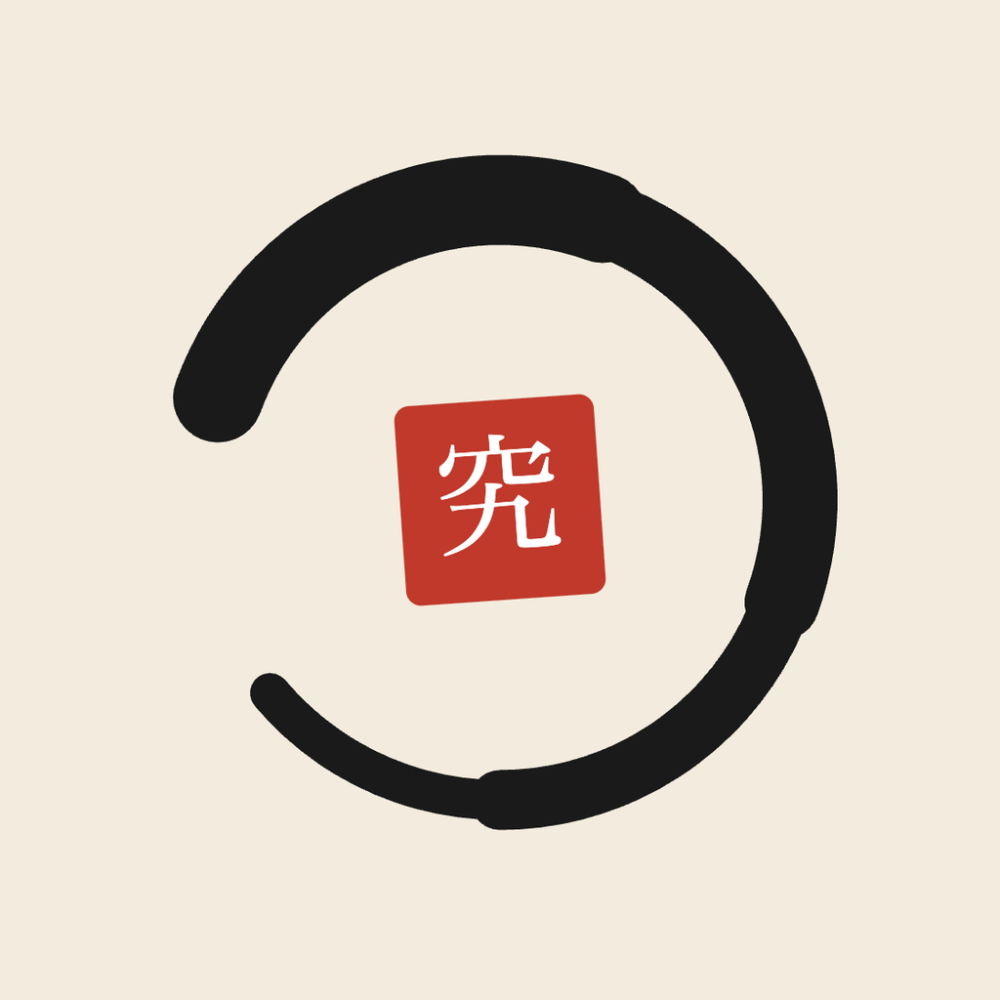

 

# Quidist

# *Curiosity creates possibilities.*

### *Gatal? Garuk sampai ke akarnya.*

 

## Halo

Quidist itu lab teknologi kecil yang isinya orang-orang penasaran.

Di sini kami bikin proyek, coba ide, gagal, coba lagi — kalau jadi, kami buka ke publik. Tidak ada tekanan, tidak ada deadline klien, tidak ada yang marah kalau eksperimen tidak berhasil.

Yang ada cuma rasa ingin tahu, keyboard, sama kopi.

 

## Kenapa namanya Quidist?

Dari kata Latin **quid** — artinya *"apa"*. Quidist itu orang yang selalu nanya *"ini sebenernya apa sih?"* sebelum pakai sesuatu. Nggak puas cuma tau permukaannya.

Dan ya, kedengarannya kayak kudis. Yups, itu bener. Persis kayak kudis yang gatelnya gatel banget — begitu juga rasa ingin tahu kami. Makin belum ketemu jawabannya, makin gatal. Makin gatal, makin digaruk. Dan kami nggak berhenti sampai ketemu akarnya.

> *Penasaran itu gatal. Garuk sampai ke akarnya.*

 

## Visi

Jadi lab teknologi independen yang keren, produktif, dan open source. Kalau bisa sambil rebahan juga boleh.

 

## Misi

**Explore Beyond Boundaries**
Jelajahi teknologi apa aja — asal menarik, gaskeun. Nggak perlu nunggu tren, nggak perlu izin siapa pun.

**Experiment Through Evidence**
Jangan cuma bilang *"kayaknya bisa"*. Coba. Ukur. Buktikan. Kalau ternyata nggak bisa, ya sudah, itu juga pelajaran.

**Build What Matters**
Kalau idenya bagus, bangun. Kalau udah dibangun dan ternyata nggak ada yang pakai, anggap aja latihan.

**Advance Engineering Excellence**
Kode yang bagus itu bukan kode yang keliatan pinter. Kode yang bagus itu kode yang temen kamu nggak maki-maki waktu baca.

**Share Knowledge Openly**
Ilmu bukan investasi. Makin dibagi makin nambah. Push ke public, tulis dokumentasinya, biar orang lain juga bisa nebeng pinter.

**Develop People Through Practice**
Nggak ada yang langsung jago. Semua orang di sini pernah bingung juga. Belajar bareng, salah bareng, berkembang bareng.

 

## Cara Mainnya

Sesimpel ini:

1. Punya ide? Buka issue atau langsung bikin repo.
2. Mau ikut garap ide orang lain? Fork, PR, atau tinggal komen.
3. Eksperimen gagal? Dokumentasikan. Kegagalan yang terdokumentasi lebih berharga dari sukses yang nggak dicatat.
4. Nggak tau harus mulai dari mana? Lihat repo yang ada, pilih yang bikin kamu gatal.

Nggak perlu minta izin dulu. Nggak perlu takut keliatan bodoh. Di sini semua orang masih belajar, termasuk yang udah lama.

 

## Boleh ikut?

Kalau kamu suka eksplorasi, suka coba hal baru, dan nggak takut keliatan nggak tau — kamu ada di tempat yang tepat.

Lihat repo-repo kami, fork yang menarik, buka issue, atau ajak ngobrol. Lab ini bukan milik siapa-siapa, tapi milik semua orang yang mau ikut berkontribusi.

 

*Explore. Experiment. Engineer.*

